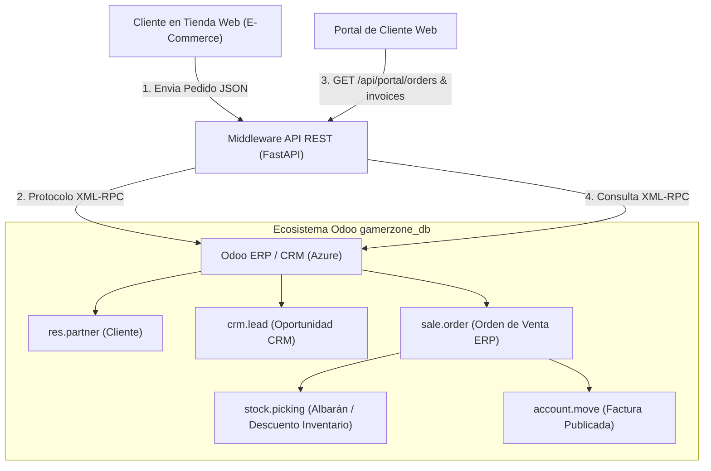

# Manual Técnico de Integración Backend (ERP + CRM + E-Commerce) y Portal de Cliente

**Curso:** Sistemas Organizacionales y Gerenciales 1  
**Semestre:** Segundo Semestre 2026  
**Proyecto:** Transformación Digital en E-Commerce con ERP, CRM y BI – QuetzalDev  
**Fase:** Fase 3 — Integración, Pruebas y Análisis Final  
**Rol Asignado:** **INTEGRANTE 2 — Integración Backend y Portal de Cliente**  
**Empresa Ficticia:** GamerZone (E-Commerce de Hardware y Periféricos Gamer)  
**Base de Datos en Azure:** `gamerzone_db`  
**Host Odoo en la Nube:** `http://gamerzone-odoo.northcentralus.cloudapp.azure.com:8069`  

---

## 1. Resumen de Responsabilidades del Integrante 2

El presente manual técnico detalla la arquitectura, implementación, conectores y pruebas de los 5 requerimientos asignados al **Integrante 2**:
1. **Configuración de la conexión Web $\leftrightarrow$ Odoo ERP/CRM:** Middleware con API REST en Python/FastAPI que procesa los pedidos del E-Commerce y genera automáticamente órdenes de venta en el ERP y oportunidades en el CRM sin intervención manual.
2. **Implementación de Facturación Funcional:** Generación y validación automática de la Factura de Cliente (`account.move`) en estado publicado/emitido al momento de confirmar la compra.
3. **Configuración del Portal de Cliente:** Interfaz y endpoints que permiten al cliente consultar el estado en tiempo real de sus pedidos de venta y facturas emitidas utilizando su correo electrónico.
4. **Ejecución de Pruebas de Flujo Completo:** Verificación de la cadena: *Compra del cliente $\rightarrow$ Descuento de stock en almacén $\rightarrow$ Registro de venta en CRM $\rightarrow$ Emisión de factura contable $\rightarrow$ Trazabilidad en Portal*.
5. **Documentación Técnica:** Mapeo de campos, especificación de endpoints y diagrama de flujo de datos.

---

## 2. Arquitectura de la Solución

Para garantizar la seguridad de las credenciales maestras y evitar problemas de CORS en navegadores web, se implementó un **Middleware de Integración** basado en **FastAPI (Python)** que actúa como puente de comunicación bidireccional entre la tienda web y Odoo ERP:



---

## 3. Especificación de Endpoints del Middleware REST

El servidor middleware corre en el puerto `8000` y expone documentación interactiva Swagger en `/docs`.

### 3.1. `GET /api/products`
* **Descripción:** Obtiene los productos publicables activos desde el ERP con su precio y stock disponible en tiempo real.
* **Respuesta Exitosa (HTTP 200):**
```json
{
  "success": true,
  "count": 45,
  "products": [
    {
      "id": 67,
      "name": "HyperX Cloud II",
      "price": 699.0,
      "stock": 4.0,
      "category": "Todos / GamerZone GT / Audífonos",
      "description": ""
    }
  ]
}
```

---

### 3.2. `POST /api/checkout`
* **Descripción:** Procesa la compra del carrito, registra el cliente, crea el lead en CRM, genera y confirma la orden de venta (descontando stock) y emite la factura contable automáticamente.
* **Cuerpo de la Petición (Request JSON):**
```json
{
  "customer": {
    "name": "Carlos Estuardo Perez",
    "email": "carlos.perez@gamerzone.gt",
    "phone": "5555-8899",
    "address": "6ta Avenida 15-20 Zona 10",
    "city": "Guatemala"
  },
  "items": [
    {
      "product_id": 67,
      "name": "HyperX Cloud II",
      "price_unit": 699.0,
      "quantity": 1
    }
  ]
}
```
* **Respuesta Exitosa (HTTP 200):**
```json
{
  "success": true,
  "message": "Pedido procesado y facturado automáticamente en Odoo ERP y CRM.",
  "data": {
    "customer_id": 48,
    "crm_lead_id": 6,
    "sale_order_id": 4,
    "order_number": "S00004",
    "order_state": "sale",
    "picking_ids": [7],
    "invoice": {
      "id": 2,
      "name": "INV/2026/10/0002",
      "state": "posted",
      "amount_total": 699.0,
      "payment_state": "not_paid",
      "invoice_date": "2026-10-19"
    },
    "total": 699.0
  }
}
```

---

### 3.3. `GET /api/portal/orders`
* **Descripción:** Permite al portal de cliente consultar las órdenes de venta registradas para un correo electrónico.
* **Parámetros URL:** `?email=carlos.perez@gamerzone.gt`
* **Respuesta Exitosa (HTTP 200):**
```json
{
  "success": true,
  "email": "carlos.perez@gamerzone.gt",
  "count": 1,
  "orders": [
    {
      "id": 4,
      "order_number": "S00004",
      "date": "2026-10-19 21:45:01",
      "total": 699.0,
      "state": "sale",
      "state_display": "Orden Confirmada",
      "has_delivery": true
    }
  ]
}
```

---

### 3.4. `GET /api/portal/invoices`
* **Descripción:** Permite al portal de cliente consultar las facturas de venta asociadas a su correo electrónico.
* **Parámetros URL:** `?email=carlos.perez@gamerzone.gt`
* **Respuesta Exitosa (HTTP 200):**
```json
{
  "success": true,
  "email": "carlos.perez@gamerzone.gt",
  "count": 1,
  "invoices": [
    {
      "id": 2,
      "invoice_number": "INV/2026/10/0002",
      "date": "2026-10-19",
      "total": 699.0,
      "state": "posted",
      "state_display": "Emitida / Publicada",
      "payment_state": "not_paid",
      "payment_display": "Pendiente de Pago"
    }
  ]
}
```

---

## 4. Mapeo de Datos entre Sistemas

Para garantizar una trazabilidad transparente y sin pérdida de datos, los campos del JSON web se mapean a los modelos nativos de Odoo de la siguiente manera:

| Modelo de Odoo | Propósito | Campo en Odoo | Origen en E-Commerce (Web) | Tipo de Dato |
| :--- | :--- | :--- | :--- | :--- |
| `res.partner` | Cliente | `name` | `customer.name` | String |
| `res.partner` | Cliente | `email` | `customer.email` | String (Clave de búsqueda) |
| `res.partner` | Cliente | `phone` | `customer.phone` | String |
| `res.partner` | Cliente | `street` | `customer.address` | String |
| `res.partner` | Cliente | `city` | `customer.city` | String |
| `crm.lead` | Oportunidad CRM | `name` | `Venta Web - {customer.name}` | String |
| `crm.lead` | Oportunidad CRM | `partner_id` | ID devuelto por `res.partner` | Many2one |
| `crm.lead` | Oportunidad CRM | `expected_revenue`| Suma total de `items` | Float |
| `crm.lead` | Oportunidad CRM | `probability` | `100` (Venta concretada) | Float |
| `sale.order` | Orden de Venta | `partner_id` | ID devuelto por `res.partner` | Many2one |
| `sale.order` | Orden de Venta | `opportunity_id`| ID devuelto por `crm.lead` | Many2one |
| `sale.order.line` | Líneas de Orden | `product_id` | `item.product_id` | Many2one |
| `sale.order.line` | Líneas de Orden | `product_uom_qty`| `item.quantity` | Float |
| `sale.order.line` | Líneas de Orden | `price_unit` | `item.price_unit` | Float |
| `stock.picking` | Despacho Almacén | `origin` | Número de orden (ej. `S00004`)| String (Automático) |
| `account.move` | Factura Cliente | `invoice_origin`| Número de orden (ej. `S00004`)| String (Automático) |
| `account.move` | Factura Cliente | `state` | `posted` (Publicada/Validada) | Selection |

---

## 5. Implementación de Facturación Funcional

Odoo protege métodos privados como `_create_invoices()` contra llamadas remotas XML-RPC no seguras. Para implementar la facturación automática de forma 100% estándar:

1. Se inicializa el wizard nativo `sale.advance.payment.inv` pasando en el contexto el `active_id` de la orden de venta:
   ```python
   wiz_id = models.execute_kw(
       db, uid, password,
       'sale.advance.payment.inv', 'create',
       [{'advance_payment_method': 'percentage', 'amount': 100}],
       {'context': {'active_ids': [order_id], 'active_model': 'sale.order'}}
   )
   ```
2. Se ejecuta el método `create_invoices` del wizard para generar la factura borrador vinculada.
3. Se invoca el método oficial `action_post` en el modelo `account.move` sobre el ID de la factura generada:
   ```python
   models.execute_kw(db, uid, password, 'account.move', 'action_post', [[invoice_id]])
   ```
4. Odoo asigna automáticamente la secuencia contable oficial (ejemplo: `INV/2026/10/0002`), genera los asientos contables y la pone a disposición del cliente.

---

## 6. Evidencias de Ejecución (Script `tests/test_flow.py`)

A continuación se presenta la evidencia de ejecución del script de validación integral:

```text
================================================================================
 INICIANDO PRUEBA DE FLUJO COMPLETO DE INTEGRACIÓN (INTEGRANTE 2)
================================================================================
Conectando con Odoo ERP en Azure...
✅ Conexión exitosa. Autenticado como UID: 2 en DB: 'gamerzone_db'

================================================================================
 PASO 1: Consulta de Catálogo de Productos desde ERP
================================================================================
Total de productos de muestra obtenidos: 5
 • [67] HyperX Cloud II | Categoría: Todos / GamerZone GT / Audífonos | Precio: Q699.0 | Stock Actual: 4.0
 • [46] Logitech G435 LIGHTSPEED | Categoría: Todos / GamerZone GT / Audífonos | Precio: Q549.0 | Stock Actual: 9.0
 • [47] Razer BlackShark V2 X | Categoría: Todos / GamerZone GT / Audífonos | Precio: Q449.0 | Stock Actual: 8.0

================================================================================
 PASO 2: Gestión de Cliente en Odoo (res.partner)
================================================================================
Registrando cliente web: Alejandro Morales (Test Automatizado)...
[OK] Cliente registrado / verificado en Odoo con ID: 48

================================================================================
 PASO 3: Registro Automático de Oportunidad en CRM (crm.lead)
================================================================================
[OK] Lead / Oportunidad creada en el Pipeline del CRM con ID: 6
   Monto esperado: Q699.0 | Probabilidad: 100% | Estado: Ganada/En Proceso

================================================================================
 PASO 4: Generación de la Orden de Venta en el ERP (sale.order)
================================================================================
[OK] Orden de Venta creada en borrador con ID: 4 (Vinculada a Oportunidad #6)

================================================================================
 PASO 5: Confirmación de Orden y Actualización de Inventario (stock)
================================================================================
[OK] Orden de Venta confirmada: S00004 (Estado: sale)
[OK] Movimiento de Almacén (Albarán de Despacho) generado automáticamente con IDs: [7]

================================================================================
 PASO 6: Emisión Automática de la Factura de Cliente (account.move)
================================================================================
[OK] Factura de Cliente creada y validada automáticamente en Odoo:
   • Número de Factura: INV/2026/10/0002
   • Estado Contable: posted (Publicada)
   • Total Facturado: Q699.00

================================================================================
 PASO 7: Consulta en Tiempo Real desde el Portal de Cliente
================================================================================
Consultando órdenes encontradas en el portal:
   - No: S00004 | Fecha: 2026-10-19 21:45:01 | Total: Q699.0 | Estado: Orden Confirmada

Consultando facturas encontradas en el portal:
   - Factura: INV/2026/10/0002 | Fecha: 2026-10-19 | Total: Q699.0 | Estado: Emitida / Publicada
```

---

## 7. Instrucciones de Despliegue y Ejecución

### Requisitos Previos
* Python 3.10 o superior instalado.
* Conexión a Internet (para conectar con la instancia de Azure en `40.116.83.248:8069`).

### Instalación de Dependencias
```bash
python -m venv .venv
source .venv/bin/activate
pip install -r backend/requirements.txt
npm --prefix frontend install
npm --prefix frontend run build
```

### Ejecutar el Middleware API
```bash
python main.py
```
* El servidor iniciará en `http://localhost:8000`.
* Documentación interactiva Swagger: `http://localhost:8000/docs`.
* Tienda Web y Portal integrados: `http://localhost:8000/store/`.

### Ejecutar la Suite de Pruebas de Flujo Completo
```bash
python tests/test_flow.py
```
