# Manual de usuario del sitio web GamerZone

**Proyecto:** Transformación Digital en E-Commerce con ERP, CRM y BI

**Grupo:** 12

**Módulo:** Frontend E-Commerce conectado con Odoo

**Fecha:** 21 de octubre de 2026

## 1. Objetivo

Este manual explica cómo utilizar la tienda GamerZone para:

- navegar y buscar productos sincronizados con Odoo;
- consultar información detallada de cada producto;
- agregar, quitar y modificar productos del carrito;
- registrar o actualizar los datos de un cliente;
- generar una cotización oficial en Odoo;
- convertir una cotización en orden de venta;
- adjuntar una Tarjeta y realizar un pago simulado;
- consultar cotizaciones, órdenes y facturas desde el portal de cliente.

El sitio es responsive y puede utilizarse desde una computadora, tableta o teléfono.

## 2. Iniciar el sistema

### 2.1. Primera instalación

Desde la carpeta principal del proyecto ejecute:

```bash
python3 -m venv .venv
source .venv/bin/activate
pip install -r backend/requirements.txt

cd frontend
npm install
npm run build
cd ..

cp .env.example .env
```

Configure en `.env` la conexión y credenciales de integración de Odoo antes de iniciar el backend.

### 2.2. Iniciar la aplicación

```bash
source .venv/bin/activate
cd backend
python main.py
```

Abra la siguiente dirección en un navegador moderno:

```text
http://localhost:8000/store/
```

La API y su documentación también están disponibles en:

```text
http://localhost:8000/docs
http://localhost:8000/api/health
```

## 3. Página de inicio y navegación

La página principal presenta la identidad visual de GamerZone en azul oscuro y negro. En la parte superior encontrará:

- **Catálogo:** abre todos los productos disponibles.
- **Crear cuenta:** registra o actualiza los datos del cliente.
- **Mis pedidos:** abre el portal de cotizaciones, órdenes y facturas.
- **Buscador:** permite buscar por nombre o SKU.
- **Carrito:** muestra la cantidad total de unidades agregadas.

En teléfonos aparece una barra inferior con accesos permanentes a Inicio, Catálogo, Carrito, Pedidos y Cuenta.

La página también presenta categorías, promociones, productos recomendados y accesos al portal.

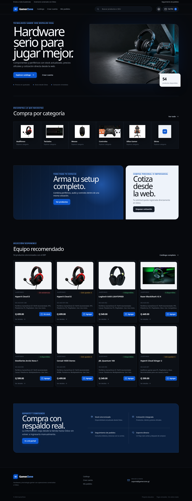

## 4. Consultar el catálogo

1. Seleccione **Catálogo** o **Explorar catálogo**.
2. Escriba un nombre o SKU en el campo de búsqueda.
3. Seleccione una categoría, por ejemplo **Audífonos**, **Controles** o **Mouse**.
4. Utilice el selector de orden para mostrar:
   - recomendados;
   - precio menor;
   - precio mayor;
   - orden alfabético.
5. Active **Solo disponibles** para ocultar productos agotados.
6. Use **Limpiar filtros** para regresar al catálogo completo.
7. Si existen más resultados, seleccione **Ver más productos**.

Cada tarjeta muestra categoría, existencia, nombre, SKU, precio oficial y acceso al detalle. El indicador cambia entre disponibilidad normal, últimas unidades y agotado. Los precios y existencias provienen del catálogo actual de Odoo.

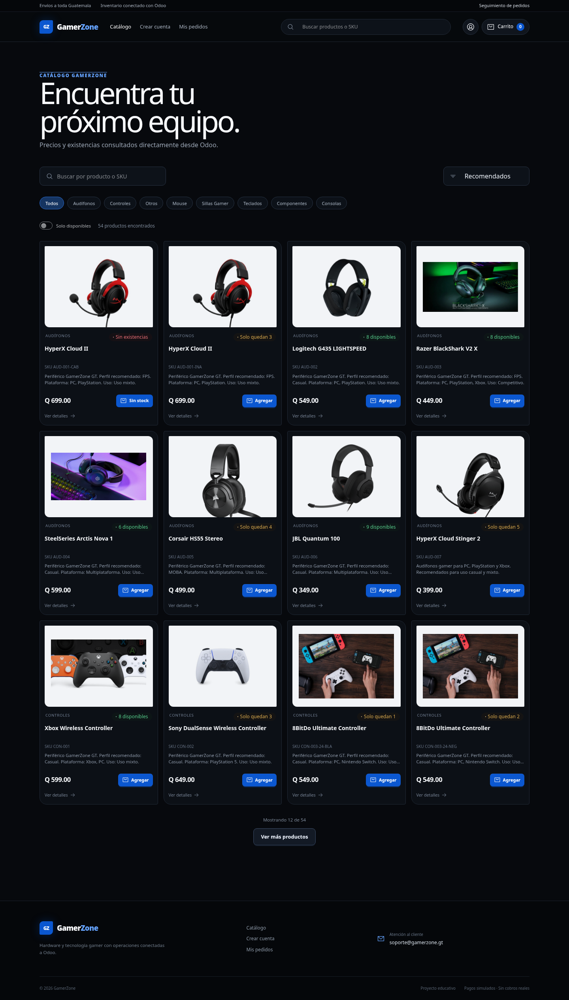

Si Odoo no responde, el sitio muestra un mensaje de error y el botón **Intentar de nuevo**. Si la búsqueda no encuentra resultados, se muestra un estado vacío sin eliminar los filtros seleccionados.

## 5. Ver el detalle de un producto

Seleccione la imagen, el nombre o **Ver detalles** dentro de una tarjeta. La pantalla individual muestra:

- nombre y categoría;
- SKU;
- descripción;
- existencia disponible;
- precio oficial;
- selector de cantidad;
- productos relacionados.

Use `−` y `+` para elegir una cantidad y presione **Agregar al carrito**.

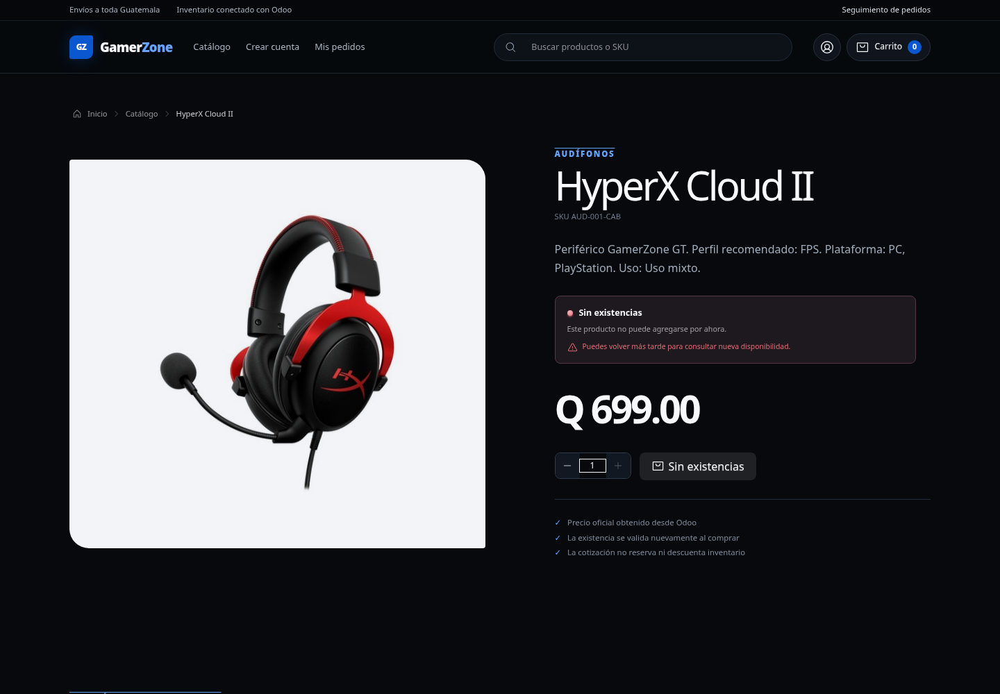

## 6. Administrar el carrito

Al seleccionar **Agregar**, el contador del carrito se actualiza y aparece una confirmación. Presione **Carrito** en la navegación para abrir el panel lateral.

Desde este panel puede:

1. aumentar o reducir cantidades con `−` y `+`;
2. eliminar una línea mediante el icono de papelera;
3. consultar el subtotal por producto;
4. revisar el total estimado;
5. abrir **Ver carrito completo**;
6. continuar con **Generar cotización**.

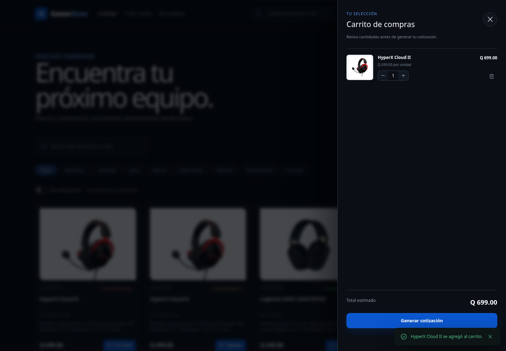

En la página completa del carrito también se puede utilizar **Vaciar carrito**. El contenido queda guardado localmente en el navegador, por lo que se conserva al recargar la página.

> El total del carrito es estimado. Cuando se crea la cotización, el backend vuelve a consultar nombres, disponibilidad y precios oficiales en Odoo.

## 7. Registrar o actualizar un cliente

1. Seleccione **Crear cuenta**.
2. Complete los siguientes campos:
   - nombre completo;
   - correo electrónico;
   - teléfono;
   - ciudad;
   - dirección.
3. Presione **Crear cuenta**.
4. Espere el mensaje **Tus datos quedaron registrados en Odoo**.

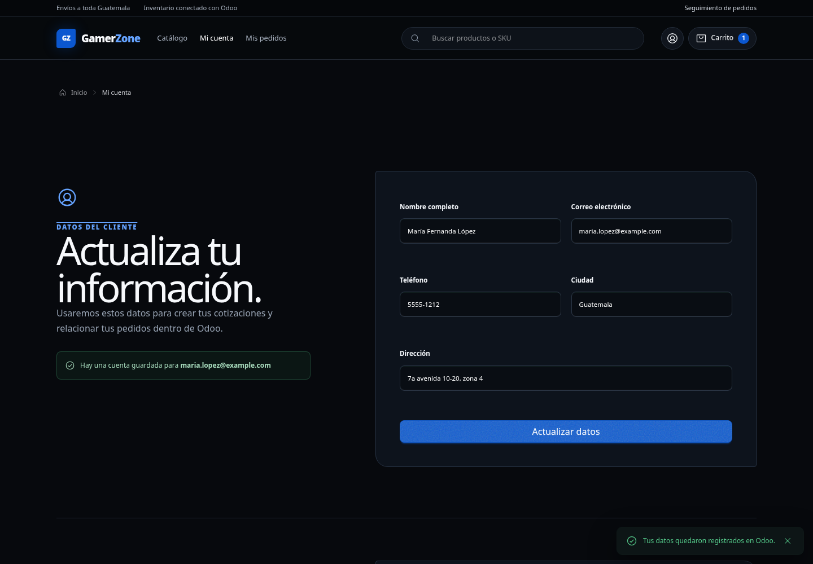

El cliente se registra como contacto `res.partner` en Odoo. Si ya existe un contacto con el mismo correo, sus datos se actualizan en lugar de crear un duplicado.

Los datos también se guardan en el navegador para completar automáticamente futuras cotizaciones. Este registro no crea una contraseña: el alcance actual corresponde a registro de cliente, no a autenticación de usuario.

## 8. Generar una cotización

Para cotizar debe existir al menos un producto en el carrito.

1. Abra el carrito y seleccione **Generar cotización**.
2. Confirme o complete los datos del cliente.
3. Presione **Revisar productos**.
4. Revise productos, cantidades, cliente y total estimado.
5. Presione **Solo cotizar**.

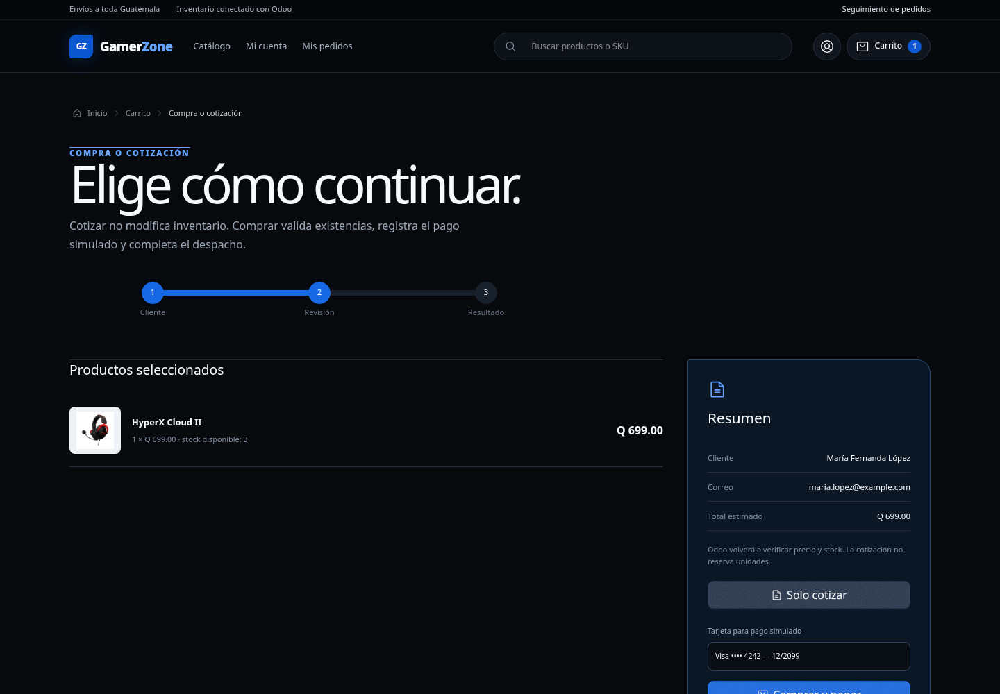

El sistema ejecuta estas acciones sin confirmar la venta ni modificar inventario:

1. identifica o actualiza al cliente en Odoo;
2. vuelve a consultar cada producto y su precio oficial;
3. crea una oportunidad en CRM con probabilidad inicial de 25 %;
4. crea una `sale.order` en estado `draft`;
5. devuelve el número y total oficial de la cotización.

El navegador no envía un precio confiable a Odoo; el backend reconstruye las líneas con los valores oficiales para evitar cotizaciones manipuladas.

El backend también verifica que la cantidad solicitada no supere la existencia actual. Esta comprobación se repite al comprar porque el stock puede cambiar después de guardar una cotización.

## 9. Adjuntar una Tarjeta

1. Abra **Crear cuenta** y registre sus datos.
2. En **Métodos de pago**, complete titular, número, mes, año y CVV.
3. Presione **Adjuntar tarjeta**.

Puede utilizar `4242 4242 4242 4242` en la demostración. El servicio no se conecta con un banco y no limita el saldo. El número completo y el CVV se utilizan únicamente para validar el formulario y se descartan; solamente se conservan la marca, los últimos cuatro dígitos y el vencimiento.

## 10. Cotización creada

Después de guardar, se muestra el número asignado por Odoo, su estado y total oficial.

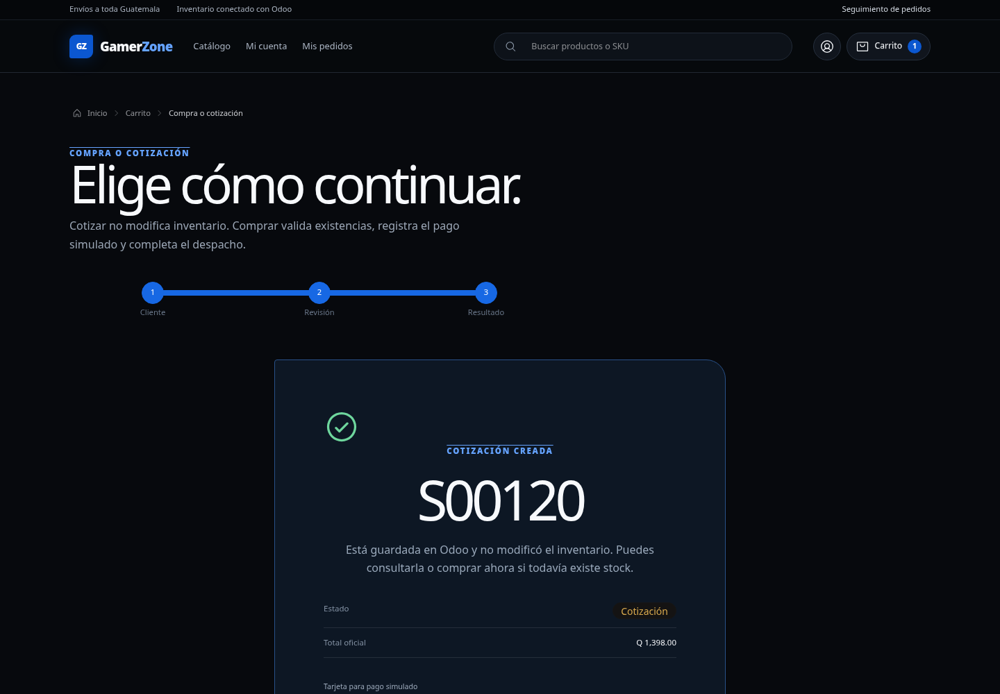

En esta pantalla puede:

- seleccionar **Ver detalle** para consultar las líneas guardadas;
- dejar la cotización en borrador y consultarla después en **Mis pedidos**;
- seleccionar una tarjeta y **Pagar y convertir en orden** para confirmar la compra.

## 11. Comprar o convertir la cotización en orden

1. Seleccione una Tarjeta y presione **Comprar y pagar** o **Pagar y convertir en orden**.
2. Revise productos, unidades, total y tarjeta en la confirmación final.
3. Presione **Confirmar y pagar**. Puede utilizar **Volver** si necesita corregir algo.
4. El backend verifica que el correo corresponda al cliente propietario de la cotización.
5. El backend vuelve a comprobar la existencia. Si no alcanza, rechaza la compra sin confirmarla.
6. Odoo confirma la `sale.order`, reserva el inventario y valida el despacho para descontar la existencia física.
7. La oportunidad de CRM se actualiza a 100 %.
8. El servicio registra un pago educativo aprobado y genera un recibo `SIM-...`.
9. El sistema intenta crear y publicar la factura.
10. El sitio abre el detalle de la orden confirmada y presenta su trazabilidad.

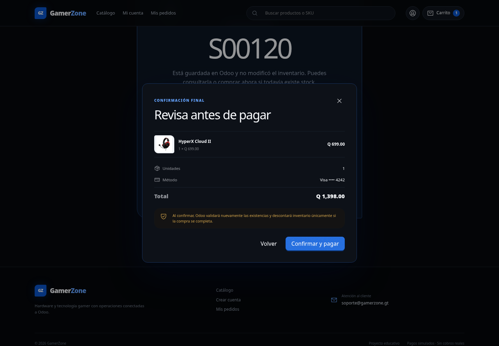

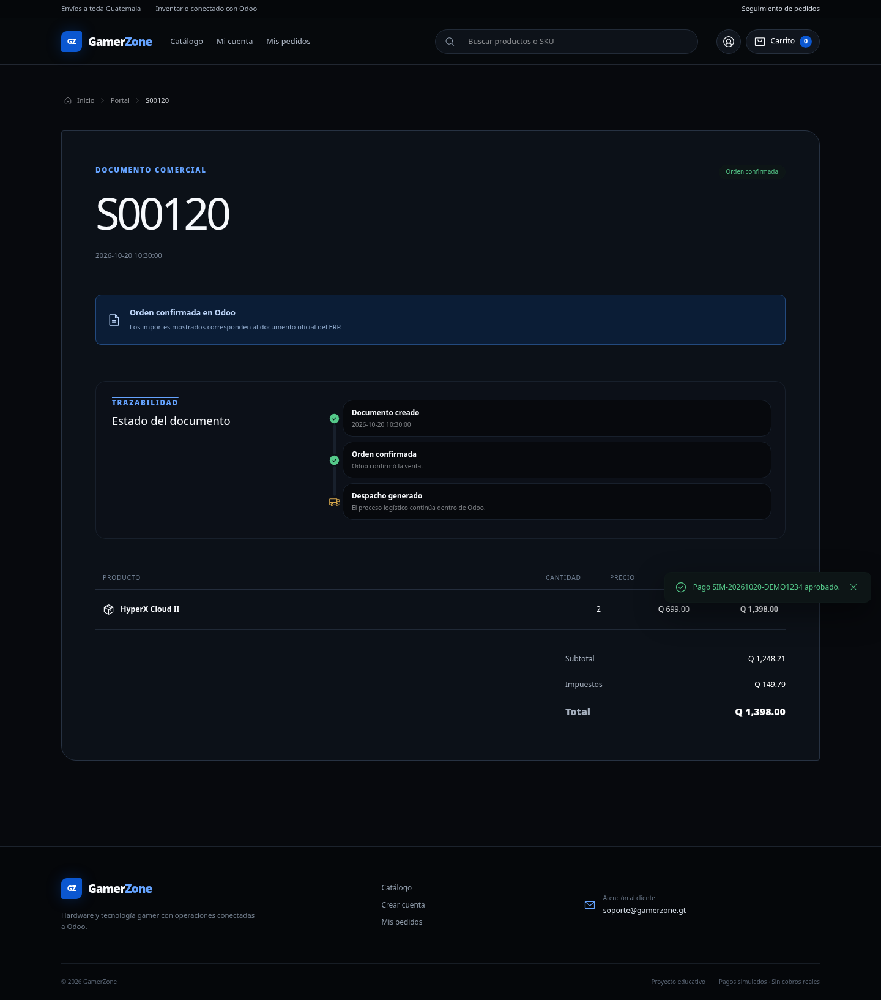

El detalle incluye estado, productos, cantidades, precios, subtotal, impuestos y total oficial. Una misma cotización no puede confirmarse dos veces.

Si la orden se confirma pero la configuración contable impide crear la factura, el sitio conserva la orden confirmada y muestra una advertencia para completar la facturación desde Odoo. Esto evita repetir accidentalmente la confirmación.

## 12. Portal de cliente: pedidos y cotizaciones

1. Seleccione **Mis pedidos**.
2. Ingrese el mismo correo utilizado durante el registro o la cotización.
3. Presione **Consultar**.
4. Abra la pestaña **Pedidos**.

El resumen superior muestra cuántos documentos, facturas y pagos existen. La lista diferencia cotizaciones, cotizaciones enviadas, órdenes confirmadas, órdenes completadas y documentos cancelados. Puede buscar por número o estado y filtrar entre cotizaciones y pedidos confirmados. Seleccione una fila para abrir su detalle.

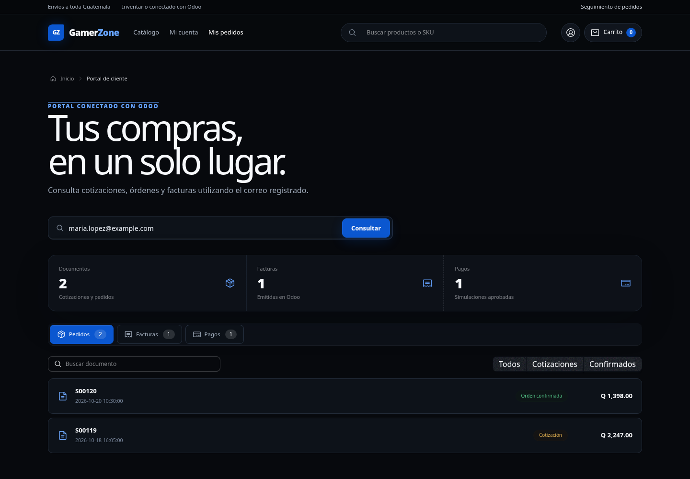

## 13. Portal de cliente: facturas y pagos simulados

Dentro del portal, seleccione **Facturas**. Se muestran:

- número de factura;
- fecha;
- estado de pago;
- total facturado.

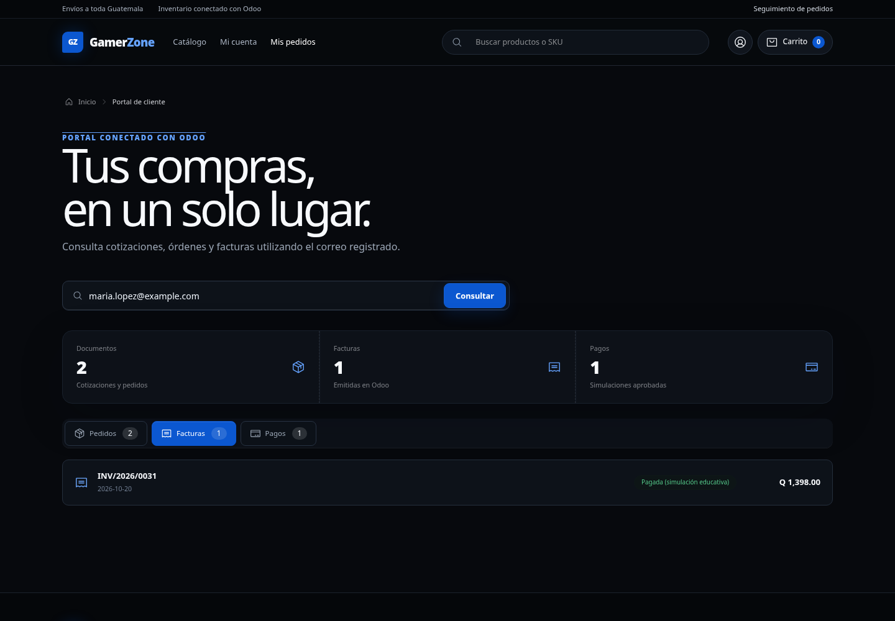

El portal actual identifica al cliente mediante su correo. No utiliza usuario y contraseña porque la autenticación no forma parte del alcance original del Integrante 1.

La pestaña **Pagos simulados** muestra el recibo, la orden, la tarjeta enmascarada, el estado aprobado y el total. Este registro es académico y no representa una transacción bancaria real.

## 14. Administración del sistema

La tienda no incluye un panel administrativo independiente. Los responsables del negocio administran la información directamente desde Odoo:

```text
http://40.116.83.248:8069/web
```

Desde Odoo se gestionan productos, clientes, CRM, cotizaciones, órdenes, inventario y facturas. Las credenciales administrativas nunca deben introducirse en el frontend público.

## 15. Mensajes frecuentes

| Mensaje | Significado | Acción recomendada |
|---|---|---|
| Tu carrito está vacío | No existen productos para cotizar | Agregue al menos un producto del catálogo |
| No pudimos cargar esta información | FastAPI u Odoo no respondió | Verifique `/api/health` y seleccione **Intentar de nuevo** |
| Odoo tardó demasiado en responder | La conexión superó el tiempo de espera | Espere unos segundos e intente nuevamente |
| Ingresa un correo válido | El formato del correo no es correcto | Corrija el correo antes de continuar |
| Productos no disponibles | Un producto fue desactivado en Odoo | Retírelo del carrito o actualice el catálogo |
| Stock insuficiente | La cantidad solicitada supera la existencia actual | Reduzca la cantidad según lo indicado por el sistema |
| La tarjeta seleccionada no pertenece a este cliente | Se intentó utilizar otro método de pago | Seleccione una tarjeta adjunta al correo actual |
| El correo no corresponde a esta cotización | El documento pertenece a otro contacto | Utilice el correo con el que se creó la cotización |
| La cotización ya fue convertida | La orden ya está confirmada o cancelada | Consulte el documento desde **Mis pedidos** |
| La factura quedó pendiente | La orden fue confirmada, pero Odoo no pudo facturar | Revise la configuración contable desde Odoo |

## 16. Flujo completo resumido

```text
Inicio
  -> Catálogo y detalle de producto
  -> Carrito
  -> Registro o identificación del cliente
  -> Revisión
  -> Opción A: cotización en Odoo, sin movimiento de stock
  -> Opción B: validación de stock y pago educativo
  -> Orden, despacho de inventario y facturación
  -> Portal de pedidos, facturas y pagos simulados
```
